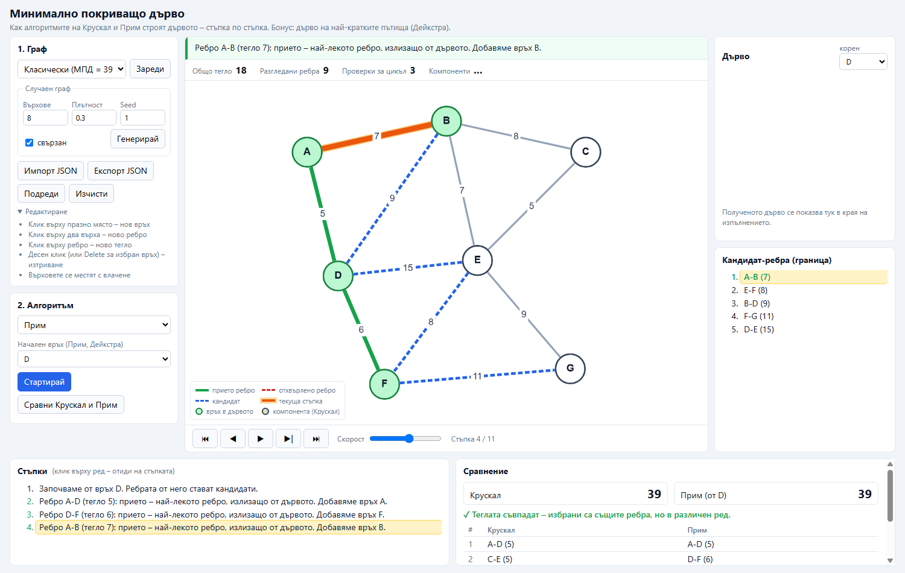

# MST demo – Kruskal and Prim, step by step

A small, portable teaching program that shows **how a minimum spanning tree (MST) is
built**. You draw or generate an undirected weighted graph, pick an algorithm, and replay
its run one decision at a time: which edge is looked at, why it is accepted or rejected,
how the tree grows. The UI is in Bulgarian.

- **Kruskal** and **Prim** (the assignment), with a compare mode that shows both
  reach the same total weight.
- **Dijkstra's shortest-path tree** as a bonus, to show that a shortest-path tree is
  *not* the same thing as an MST.
- Go backend (standard library only) + a browser UI with Cytoscape.js. Everything,
  including the UI, is built into **one binary** that works offline.



> **На български:** Програмата демонстрира построяването на минимално покриващо дърво
> с алгоритмите на Крускал и Прим (и бонус – дърво на най-кратките пътища на Дейкстра).
> Графът се рисува или генерира в браузъра, а изпълнението се възпроизвежда стъпка по
> стъпка с обяснение на всяка стъпка. Стартиране: `docker build -t mst-demo .` и
> `docker run --rm -p 8080:8080 mst-demo`, после отворете http://localhost:8080.

---

## Quick start

### With Docker

```sh
docker build -t mst-demo .
docker run --rm -p 8080:8080 mst-demo
```

Then open **http://localhost:8080**. Stop it with `Ctrl+C`.

### With Go (1.22 or newer)

```sh
go run .
```

Then open **http://localhost:8080**. To use a different port, set `PORT`:

```sh
PORT=9000 go run .           # bash / zsh
$env:PORT=9000; go run .     # PowerShell
```

### As a single binary

```sh
go build -o mst-demo .       # on Windows: go build -o mst-demo.exe .
./mst-demo
```

The binary has the web page and Cytoscape.js inside it (`go:embed`), so you can copy it
to another machine and run it with no internet connection.

---

## How to use it

The screen has four areas: settings on the left, the graph in the middle, the resulting
tree and an edge list on the right, and the step log at the bottom.

### 1. Make a graph (Граф)

| What | How |
|---|---|
| Ready-made examples | Pick a preset and click **Зареди**: the classic 7-vertex example (MST = 39), a 3×3 grid full of equal weights, and a disconnected graph |
| Random graph | Set the number of vertices, density (0–1) and seed, then click **Генерирай**. The same seed always gives the same graph. With **свързан** checked, a random spanning tree is added first, so the graph is connected |
| Add a vertex | Click an empty spot on the canvas |
| Add an edge | Click one vertex, then another, then type the weight |
| Change a weight | Click the edge |
| Delete | Right-click a vertex or an edge (or select a vertex and press `Delete`) |
| Move a vertex | Drag it |
| Save / load | **Експорт JSON** downloads `graph.json`; **Импорт JSON** loads one |
| Tidy up | **Подреди** runs a force-directed layout; **Изчисти** empties the canvas |

Weights are whole numbers. Negative weights are fine for the MST algorithms, but not for
Dijkstra.

### 2. Run an algorithm (Алгоритъм)

Choose **Крускал**, **Прим** or **Дейкстра**. Prim and Dijkstra start from the vertex
chosen under **Начален връх**. Click **Стартирай**: the backend computes the whole run
and the replay starts playing.

### 3. Watch the replay

- Buttons under the graph: `⏮` start, `◀` step back, `▶`/`⏸` play/pause, `▶|` step
  forward, `⏭` end, plus a speed slider.
- Keyboard: `←` / `→` step, `Space` plays or pauses.
- Click any line in the **Стъпки** log to jump to that step.
- The bar above the graph explains the current step, and the counters below it show the
  running total weight, edges examined, cycle checks and components.

What the colors mean:

| On the graph | Meaning |
|---|---|
| green thick edge | accepted into the tree |
| red dashed edge | rejected (it would close a cycle; for Dijkstra: no shorter path) |
| blue dashed edge | candidate (Prim's frontier, Dijkstra's tentative edges) |
| orange glowing edge | the edge handled in the current step |
| colored vertices (Kruskal) | vertices with the same color are in the same union-find component |
| green vertices (Prim, Dijkstra) | vertices already in the tree |
| `B` with `7` under it (Dijkstra) | vertex B, shortest distance found so far is 7 |

The list on the right shows **all edges in sorted order** for Kruskal (accepted, rejected,
and the ones never needed). For Prim and Dijkstra it shows the **current candidate edges**,
cheapest first.

### Tree view

When the replay reaches the end, the result is drawn again on the right as a **rooted
tree** (hierarchical layout). Pick the root with **корен**. For a disconnected graph you
get one rooted tree per component.

### Compare mode

**Сравни Крускал и Прим** runs both algorithms on the current graph and shows:

- both total weights side by side (they are always equal: every MST of a graph has the
  same weight),
- whether they chose the same edges (with equal weights there can be several different
  MSTs),
- a table with the **order** in which each algorithm picked its edges. Kruskal picks
  them globally from light to heavy; Prim grows one tree outward from the start vertex.

---

## The algorithms

All three record every decision as a step, and the browser only replays those steps.

### Kruskal – O(E log E)

1. Sort all edges by weight.
2. Go through them from lightest to heaviest. For each edge `u-v`, ask the
   **union-find** structure whether `u` and `v` are already in the same component.
   - Different components: **accept** the edge and merge the two components.
   - Same component: **reject** it, because it would close a cycle.
3. Stop as soon as the tree has V−1 edges.

Sorting costs O(E log E). With *path compression* and *union by rank*, each union-find
check is almost O(1) (inverse Ackermann), so the sort dominates.

### Prim – O(E log V)

1. Start with a tree containing only the start vertex. Put its edges in a **min-heap**
   (`container/heap`).
2. Repeatedly take the cheapest edge from the heap:
   - If its far end is not in the tree yet: **accept** it, add that vertex, and push
     the vertex's edges to the heap.
   - If both ends are already in the tree: **reject** it (cycle). This is the "lazy"
     version of Prim; edges that became useless are thrown away when they come out of
     the heap.

Each edge is pushed and popped at most once, so the cost is O(E log E) = O(E log V)
(since E ≤ V², log E ≤ 2 log V).

### Dijkstra's shortest-path tree – O((V + E) log V) (bonus)

The same heap idea, but ordered by **distance from the start** instead of edge weight.
The result connects every vertex to the start along a shortest path. On the classic
example its weight is 44, while the MST weighs 39. The two trees answer different
questions.

### Rules that keep runs predictable

- **Tie-breaking:** edges are compared by weight first, then by their position in the
  edge list (the order they were added). The same graph always gives exactly the same
  steps.
- **Disconnected graphs:** there is no spanning tree, so both algorithms build a
  **minimum spanning forest** (one MST per component). Prim starts a new tree from the
  next unvisited vertex when its heap runs empty. The UI shows a yellow banner and the
  final message says how many trees there are.

### What the counters mean

| Counter | Kruskal | Prim | Dijkstra |
|---|---|---|---|
| Разгледани ребра (edges examined) | edges taken from the sorted list | edges pushed into the heap | edges relaxed |
| Проверки за цикъл (cycle checks) | union-find checks (one per examined edge) | heap pops checked against the tree | heap pops checked for "already final" |
| Компоненти (components) | current number of union-find components | number of trees in the final result | trees in the final result (each unreachable vertex counts as one) |

---

## API

The browser talks to one endpoint. You can call it yourself, too:

```sh
curl -X POST http://localhost:8080/api/run \
  -H "Content-Type: application/json" \
  -d '{"graph":{"nodes":[{"id":"A"},{"id":"B"},{"id":"C"}],
       "edges":[{"source":"A","target":"B","weight":1},
                {"source":"B","target":"C","weight":2},
                {"source":"A","target":"C","weight":3}]},
       "algorithm":"kruskal","start":""}'
```

**Request:** `graph` (the same shape the UI imports and exports), `algorithm`
(`kruskal`, `prim` or `dijkstra`) and `start` (a vertex id; empty means the first vertex).
Nodes may also carry `x` and `y`. The UI stores positions there and the backend
ignores them.

**Response:**

```json
{
  "steps": [
    {"kind":"sort","edge":-1,"message":"Сортираме 3 ребра по тегло …","total":0,"examined":0,"cycleChecks":0,"order":[0,1,2],"comp":[0,1,2]},
    {"kind":"accept","edge":0,"message":"Ребро A-B (тегло 1): прието – свързва две различни компоненти.","total":1,"examined":1,"cycleChecks":1,"comp":[0,0,2]},
    {"kind":"accept","edge":1,"message":"Ребро B-C (тегло 2): прието – …","total":3,"examined":2,"cycleChecks":2,"comp":[0,0,0]},
    {"kind":"done","edge":-1,"message":"Готово: минимално покриващо дърво с 2 ребра, общо тегло 3. …","total":3,"examined":2,"cycleChecks":2,"comp":[0,0,0]}
  ],
  "treeEdges": [0, 1],
  "totalWeight": 3,
  "components": 1
}
```

- `treeEdges` are indexes into `graph.edges`, in the order they were chosen.
- Each step has `kind` (`sort`, `visit`, `accept`, `reject`, `relax`, `skip`, `done`),
  `edge` (index, or −1), an optional `vertex`, a Bulgarian `message`, and the running
  `total`, `examined` and `cycleChecks`. Depending on the algorithm a step also carries
  a snapshot: `order` (Kruskal's sorted edges), `comp` (union-find root of every vertex),
  `frontier` (candidate edges) or `dist` (Dijkstra's distances).
- Invalid input (unknown vertex, duplicate id, unknown algorithm, negative weight for
  Dijkstra, malformed JSON) returns HTTP 400 with `{"error": "…"}`.
- Limits: 100 vertices, 1000 edges, vertex ids up to 32 bytes, request body up to 1 MB.
  Every step carries a snapshot (components, frontier or distances), so a run's response
  grows roughly like (V+E)·V. These limits keep even the worst case at a few MB. The
  server also has read/write timeouts.

---

## Project layout

```
main.go              HTTP server: serves the embedded UI and POST /api/run
mst/
  graph.go           types (Graph, Step, Result), validation, Run() dispatcher, tie-breaking
  unionfind.go       union-find with path compression and union by rank
  heap.go            min-heap for container/heap (used by Prim and Dijkstra)
  kruskal.go         Kruskal
  prim.go            Prim (lazy, with a heap)
  dijkstra.go        Dijkstra's shortest-path tree
  mst_test.go        unit tests
static/              the web UI (embedded into the binary)
  index.html, style.css
  app.js             runs the API and replays the steps; tree view; compare mode
  editor.js          Cytoscape graph editor, import/export
  graphs.js          presets and the seeded random graph generator
  vendor/            Cytoscape.js 3.34.4 (MIT), stored locally, no CDN
Dockerfile           multi-stage: golang:1.26-alpine build -> scratch runtime
```

No web framework, no npm and no build step: the frontend is plain ES modules served as is.

## Tests

```sh
go vet ./...
go test ./...
```

The tests in `mst/mst_test.go` cover:

- a known graph (MST weight 39) with the exact edges and step sequence for Kruskal and Prim,
- equal weights: the tie-breaking rule gives exactly the same tree every time,
- a disconnected graph: both algorithms return a 3-tree forest with the same weight,
- empty and single-vertex graphs,
- **300 random graphs** (fixed seed, small weights so ties are common): Kruskal and
  Prim always give the same total weight and the same number of components, and their
  edges never form a cycle,
- Dijkstra's distances and tree, including an unreachable vertex,
- error handling in `Run` (bad vertices, unknown algorithm, negative weights for Dijkstra).

The Docker build also runs `go vet` and `go test`, so a broken build never makes an image.
